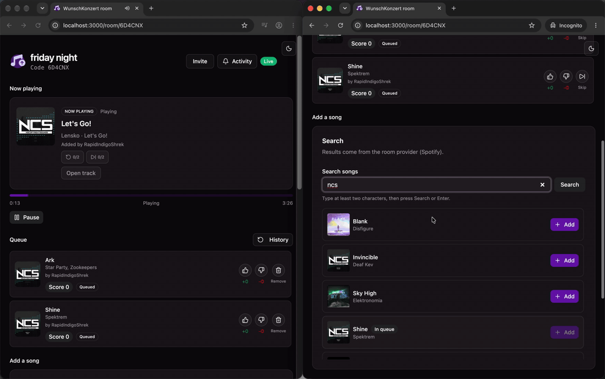

# WunschKonzert

A real-time group music room. Guests join with a short code, suggest songs and vote on what plays next. The music plays through the host's Spotify or Apple Music account.



## My Role

Linus Gattiker and I designed and built the entire backend (FastAPI, PostgreSQL, WebSockets), which runs the rooms, queue, voting and playback. Among other things I:

- Cut the database queries needed to load a room by replacing one query per song with JOIN queries, so it holds up under the 2,500-user load test.
- Added WebSocket heartbeats so users who close their tab no longer stay listed in the room.
- Made host transfer work while music is playing. The song pauses at its position and the new host resumes it from there.
- Wrote large parts of the backend test suite and the scripts that check our recoverability and security requirements.

## Features

- **Shared rooms:** The host creates a room and guests join with a 6-character code, without creating an account.
- **Song suggestions:** Everyone searches the room's music provider and adds tracks to the shared queue.
- **Voting:** Upvotes and downvotes reorder the queue live for everyone. Skip votes let the group skip the current song.
- **Host playback:** The music plays through the host's account, and every member sees the current song and its progress live.
- **Host transfer:** The host can hand the room over to a guest. Playback then switches to the new host's account.

## How It Works

| Layer | Technology |
|---|---|
| Frontend | Svelte 5 + SvelteKit, TailwindCSS 4, shadcn-svelte |
| Backend | FastAPI on Python 3.14+, SQLAlchemy 2.0 (async), WebSockets |
| Database | PostgreSQL, migrations managed with Alembic |
| Music providers | Spotify OAuth 2.0, Apple Music (MusicKit JWT) |
| Reverse proxy / TLS | Caddy (TLS 1.2+) |
| Containerization | Docker + Docker Compose |

Key design decisions:

- **One WebSocket per room member:** Votes, queue changes, playback control and host transfer all go over a single WebSocket connection, so every change reaches all members right away.
- **PostgreSQL is the source of truth:** The room state is rebuilt from the database when a member reconnects, so refreshing the page always shows a consistent room.
- **Heartbeats against ghost users:** The server sends regular pings and detects closed tabs, so members who left don't stay listed in the room.
- **No passwords of our own:** Login goes through Spotify (OAuth 2.0) and Apple Music (MusicKit). OAuth means users log in on the provider's own page and the app only receives an access token.
- **Layered backend:** API routers call services, and only services talk to the repositories that access the database. This keeps the business logic testable without a database.

## Running Locally

You need Docker with Docker Compose and a [Spotify developer app](https://developer.spotify.com/dashboard) with `http://127.0.0.1:8000/auth/spotify/callback` as a redirect URI. In-browser playback requires Spotify Premium.

```bash
git clone https://github.com/FinnSteimle/wunschkonzert.git
cd wunschkonzert
cp backend/.env.example backend/.env      # then fill in your Spotify credentials
cp frontend/.env.example frontend/.env
make run
```

Once the containers are up:

- Frontend: <http://localhost:3000>
- Backend API: <http://localhost:8000>
- API docs (Swagger UI): <http://localhost:8000/docs>

Configuration, Make targets, the full API and the WebSocket events are documented in [docs/DEVELOPMENT.md](docs/DEVELOPMENT.md).

## Testing

- **Unit tests:** fast tests without I/O for services, repositories and routers.
- **Integration tests:** run against a real PostgreSQL started with testcontainers.
- **System tests:** end-to-end browser tests with Playwright.
- **Load tests:** k6 tests for 100 and 2,500 concurrent users.

Run `make test` for unit and integration tests and `make test-cov` for the coverage report. All commands are listed in [docs/DEVELOPMENT.md](docs/DEVELOPMENT.md).

## Team

Built as the Software Engineering Project (group 15) at OST, spring semester 2026, by Finn Steimle, Linus Gattiker, Nicolas Caluori, Fabio Frick and Joëlle Schönenberger.

## License

All rights reserved. This repository is shared for portfolio purposes only. See [LICENSE.md](LICENSE.md).
